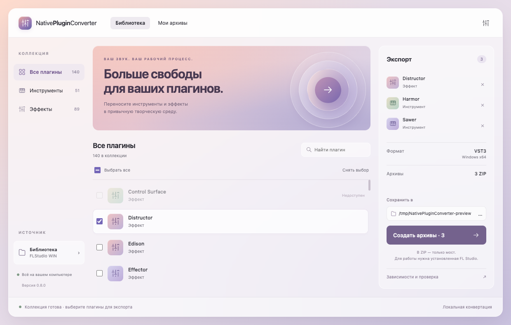
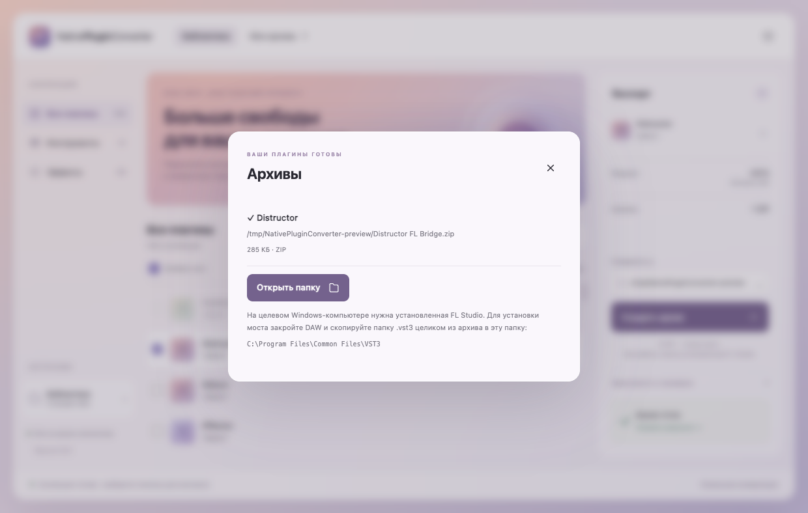

<p align="center">
  
</p>
<h1 align="center">NativePluginConverter</h1>
<p align="center"><strong>Your plugins. More places to create.</strong></p>
<p align="center">
  A desktop app for bringing native audio plugins into another DAW through a bridge.
</p>
<p align="center">
  <a href="https://github.com/h4s10/NativePluginConverter/releases">Download</a> ·
  <a href="LICENSE">MIT license</a> ·
  <a href="#get-started">Get started</a> ·
  <a href="docs/README.ru.md">Русский</a> ·
  <a href="docs/COMPATIBILITY.md">Compatibility</a> ·
  <a href="docs/BUILD.md">Build guide</a>
</p>



<p align="center"><sub>Real application capture on macOS. The current interface is in Russian. The library shown is an example, not a list of verified compatible plugins.</sub></p>

## Browse. Select. Export.

Choose instruments and effects from your local library and create a separate ZIP
for each plugin. Each archive contains the VST3 bridge, configuration, metadata
and license notices. Original plugin files stay in your own FL Studio installation.

- **One library:** search plugins and switch between instruments and effects.
- **Batch export:** select several plugins and build their archives together.
- **Native sound and interface:** the bridge hosts the original plugin where supported.
- **Creative controls:** factory preset browsing, sample drag-and-drop and instrument Channel settings, depending on the plugin.
- **Local workflow:** scanning and packaging run on your computer, with background progress and cancellation.
- **Optional launch checks:** Windows x64 can test basic loading, audio, state and editor lifecycle.

## What works today

| Component | Current support |
| --- | --- |
| Desktop converter | Windows x64, macOS Apple Silicon / Intel, Linux x64 |
| Source library | Native plugins from FL Studio for Windows x64 |
| Export format | VST3 for Windows x64 |
| Target computer | Windows x64 with its own compatible FL Studio and plugin installation |
| Other source DAWs, formats and output systems | Future work; not implemented yet |

**The app is cross-platform; the exported bridge currently runs only on Windows x64.**
Creating an archive on macOS or Linux does not create a macOS or Linux plugin.

## Download

Download the desktop app from [GitHub Releases](https://github.com/h4s10/NativePluginConverter/releases).
Choose **Windows x64**, **macOS Apple Silicon**, **macOS Intel**, or **Linux x64**
and extract the complete ZIP. Use the application archive attached to the release,
rather than GitHub's automatically generated source-code archive.

Run `NativePluginConverter.exe` on Windows, `NativePluginConverter.app` on macOS,
or `NativePluginConverter` on Linux. Windows builds are unsigned; macOS builds
are ad-hoc signed and not notarized. Exported plugins still target Windows x64.

## Get started

### Run from source

Build from source with **Node.js 24** and **Zig 0.14.1**:

```sh
npm ci
npm test
npm run build:native
npm start
```

Put Zig on `PATH`, or set `ZIG` to its executable. The Windows bridge can be
cross-compiled from macOS and Linux; FL Studio DLLs are not needed for compilation.
The interface can start without a native build, but exporting requires it.
See the [build guide](docs/BUILD.md) for desktop packages and native tests.

### Create your first bridge

1. Open **Settings** and select a Windows FL Studio folder containing `Plugins/Fruity`.
2. Scan the library, then choose your instruments and effects.
3. Pick an output folder and select **Create archive**.
4. On the target Windows computer, close your DAW and copy the complete `.vst3`
   folder from the ZIP into `C:\Program Files\Common Files\VST3`.
5. Rescan VST3 plugins in your DAW.



*One archive per plugin, with installation instructions. Creating an archive does
not verify every feature or establish that the original plugin is licensed.*

The target computer needs its own FL Studio installation and the original plugin.
**Do not copy FL Studio DLLs into the bridge folder.** Existing ZIPs are not overwritten.
On Windows, scanning a library saves the selected installation path locally;
standard installations can also be detected automatically.

For custom paths, multiple installations or archives created on another computer,
see [installation discovery](docs/INSTALLED_FL.md). Detailed dependency information
and launch results are available under **Зависимости и проверка** in the app.

## Compatibility and limits

Support varies by plugin and host DAW. Discovery in the library or a successful
launch check is not a guarantee of full compatibility. Components that require
unimplemented FL Studio host services may be unavailable. Preset, drag-and-drop,
routing and MIDI limitations are documented in the [compatibility guide](docs/COMPATIBILITY.md).

Bridge **0.6.3** fixes Edison startup and missing waveform icons in 3x Osc.
To update an existing export, close your DAW and replace the complete VST3
bundle with a fresh export. See [bridge behavior and diagnostics](docs/INSTALLED_FL.md#runtime-behavior-bridge-063).

## Inside the project

| Directory | Purpose |
| --- | --- |
| `ui/` | Electron interface |
| `src/` | Desktop process, inventory, dependency resolver and ZIP packaging |
| `native/bridge/` | Windows x64 native ABI and VST3 bridge |
| `native/third_party/pluginterfaces/` | VST3 interface headers and license |
| `tests/`, `native/tests/` | Unit tests and native/integration probes |
| `resources/` | Locally generated bridge/probe and empty compatibility cache |
| `scripts/` | Build, smoke-test and publication checks |

Additional backends, formats and platforms need their own implementation and testing.
For a bug report, include your OS, DAW, plugin version and reproduction steps.
Do not attach vendor DLLs, license keys or private files.

## License

Project-owned code is available under the [MIT license](LICENSE).
VST3 headers and toolchain components retain their own
[third-party licenses and notices](THIRD_PARTY_NOTICES.md). Keep the applicable
copyright and license notices when distributing source or binaries.

This repository contains **no Image-Line plugin DLLs, presets, fonts, samples or
FL Studio installation**. Generated binaries and plugin archives are not committed.
Exported ZIPs contain the bridge and supporting configuration/notices, not vendor assets.

MIT does not grant rights to redistribute FL Studio files or override Image-Line's
EULA. Loading installed files does not by itself
resolve legal questions about interoperability or reverse engineering.

NativePluginConverter is an independent project, not affiliated with Image-Line
or Steinberg. Product names identify compatibility.
