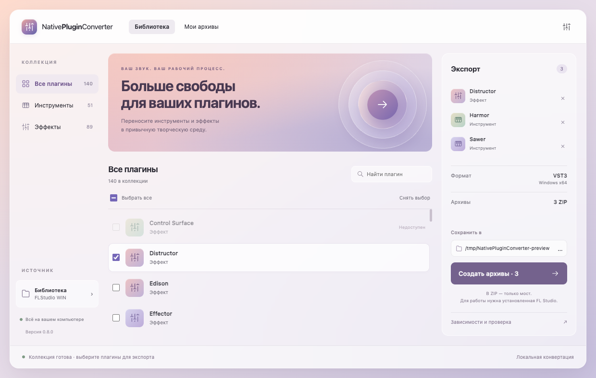
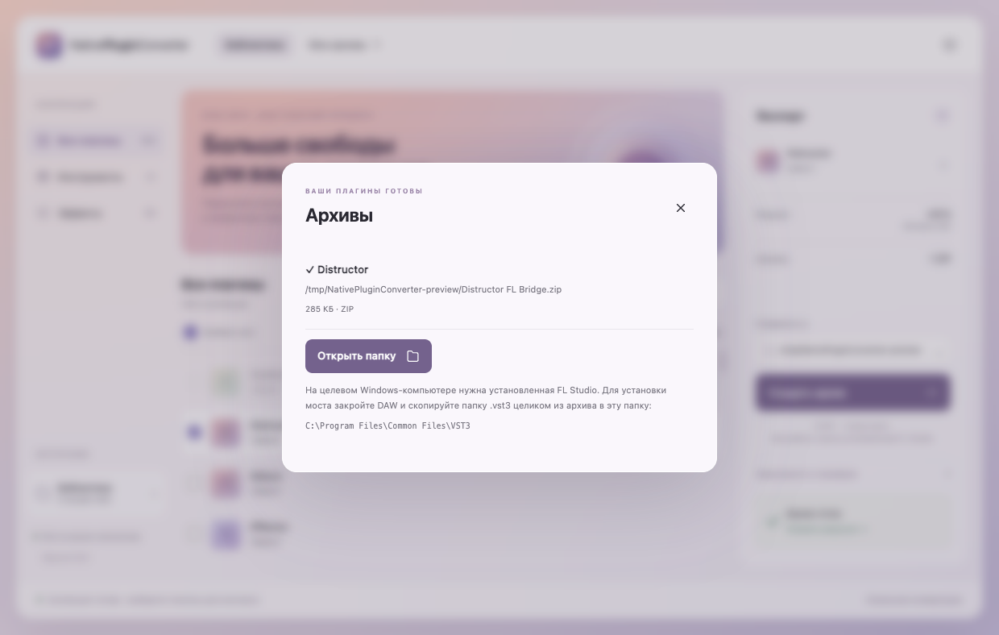

<p align="center"></p>
<h1 align="center">NativePluginConverter</h1>
<p align="center"><strong>Больше свободы для ваших плагинов.</strong></p>
<p align="center">Десктопное приложение для переноса нативных аудиоплагинов в другую DAW через мост.</p>
<p align="center"><a href="../README.md">English</a> · <a href="BUILD.md">Сборка</a> · <a href="COMPATIBILITY.md">Совместимость</a> · <a href="../LICENSE">MIT</a></p>



*Скриншот работающего приложения на macOS. Состав библиотеки приведён для примера:
обнаружение плагина не означает, что все его функции проверены.*

## Найдите. Выберите. Перенесите.

Выберите инструменты и эффекты из своей библиотеки — приложение соберёт отдельный
ZIP для каждого. В архиве находятся мост VST3, конфигурация, метаданные и лицензии.
DLL, пресеты, шрифты и сэмплы читаются из вашей установленной FL Studio.

- **Удобная библиотека:** поиск и категории инструментов и эффектов.
- **Пакетный экспорт:** несколько выбранных плагинов за одну операцию.
- **Оригинальный звук и интерфейс:** мост загружает исходный плагин, где это поддерживается.
- **Работа со звуком:** заводские пресеты, drag-and-drop сэмплов и настройки Channel — в зависимости от плагина.
- **Локальная обработка:** фоновые операции, прогресс и отмена.
- **Проверка запуска:** в Windows x64 доступны базовые проверки загрузки, звука, состояния и интерфейса.

## Что поддерживается сейчас

| Компонент | Поддержка |
| --- | --- |
| Сам конвертер | Windows x64, macOS Apple Silicon / Intel, Linux x64 |
| Источник | Нативные плагины FL Studio для Windows x64 |
| Результат | VST3 для Windows x64 |
| Компьютер с DAW | Windows x64 со своей совместимой установкой FL Studio и плагина |
| Другие DAW, форматы и системы для готовых плагинов | Пока не реализованы |

**Конвертер кроссплатформенный, но готовые мосты пока работают только в Windows x64.**
Сборка архива на Mac или Linux не создаёт плагин для этих систем.

## Запуск из исходников

Нужны **Node.js 24** и **Zig 0.14.1**. Zig должен быть в `PATH` либо указан
переменной окружения `ZIG` — путём к исполняемому файлу.

```sh
npm ci
npm test
npm run build:native
npm start
```

[Подробности сборки и упаковки приложения](BUILD.md). DLL FL Studio для компиляции
моста не нужны. Для реального экспорта потребуется ваша библиотека FL Studio для Windows.

## Первый архив

1. Откройте настройки и выберите папку FL Studio для Windows с каталогом `Plugins/Fruity`.
2. Нажмите «Найти плагины», затем выберите инструменты и эффекты.
3. Укажите папку для ZIP и нажмите «Создать архив».
4. На целевом Windows-компьютере закройте DAW и перенесите папку `.vst3` из архива
   целиком в `C:\Program Files\Common Files\VST3`.
5. Выполните сканирование VST3-плагинов в DAW.



*Для каждого плагина создаётся свой архив. Успешный экспорт не подтверждает
лицензию исходного плагина или работу всех его функций.*

На компьютере с DAW нужна своя установленная FL Studio с соответствующим плагином.
**Не копируйте её DLL в папку моста.** Существующие ZIP не перезаписываются.
«Зависимости и проверка» показывает подробности и результаты проверки запуска.
Для нестандартных путей, нескольких установок и архивов с другого компьютера
смотрите [правила выбора установки](INSTALLED_FL.md).

## Совместимость и ограничения

Поддержка зависит от плагина и DAW. Компоненты Wrapper, Patcher, VFX и некоторые
контроллеры могут требовать сервисов оригинального хоста и быть недоступны.
Ограничения пресетов, drag-and-drop, MIDI и маршрутизации описаны в
[документе о совместимости](COMPATIBILITY.md).

Мост **0.6.1** отклоняет экземпляры с обнаруженным признаком demo/trial и запросы
неподдерживаемой проверки продукта, а также учитывает запрет автоматизации от
плагина. Из-за зависимости от сервисов FL Studio могут отклоняться и купленные
плагины. Это не полноценная проверка лицензии — подробнее в
[описании ограничений](INSTALLED_FL.md#runtime-restrictions-bridge-061).

## Лицензия

Собственный код проекта распространяется под [MIT](../LICENSE).
Сторонние компоненты сохраняют свои [лицензии и уведомления](../THIRD_PARTY_NOTICES.md).
При распространении сохраняйте соответствующие тексты лицензий и сведения об авторах.

В репозитории нет проприетарных DLL, пресетов, шрифтов и сэмплов Image-Line.
Готовые ZIP не содержат ресурсов FL Studio. Не прикладывайте DLL, ключи лицензий
или личные файлы к отчётам об ошибках.

MIT не даёт прав на распространение FL Studio и не отменяет её EULA.
Использование установленной копии и ограничения demo-режима сами по себе
не решают юридические вопросы совместимости и reverse engineering.

NativePluginConverter — независимый проект, не связанный с Image-Line или Steinberg.
Названия продуктов используются для обозначения совместимости.
